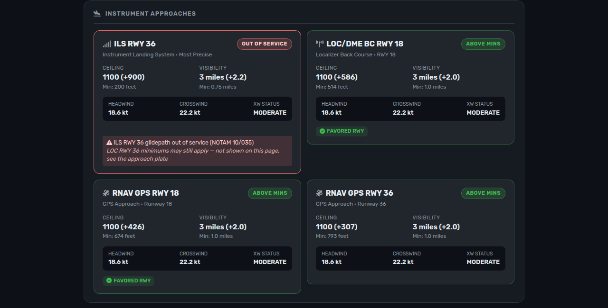
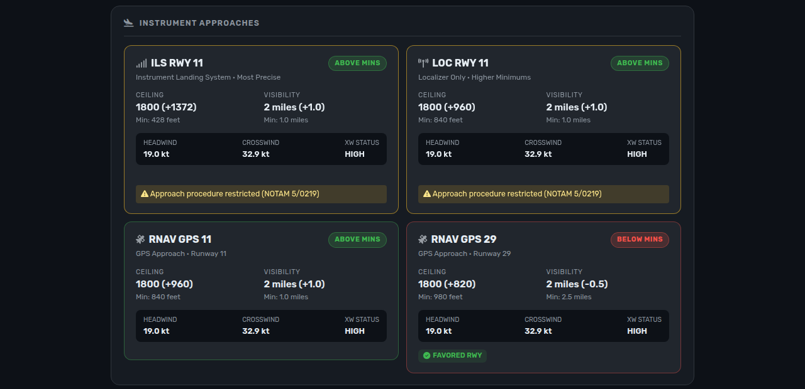

# Airport Approach

A small Docker service that watches the weather at one or more airports and answers a practical question: **are the instrument approaches above or below their minimums right now, and how long has it been that way?**

It was written for the two airports in the Pribilof Islands, Alaska (St. Paul, PASN, and St. George, PAPB), where the weather decides whether the plane comes at all. Nothing in the code is tied to them: airports, runways, approach minimums and time zone all come from one file, `airports.json`.

> **Not for flight planning or navigation.** This is a hobby project that reads public weather data. Minimums are typed in by hand from approach plates and may be out of date. Always use official sources.

## On pribiloftraffic.com

[St. Paul approaches](https://www.pribiloftraffic.com/pasnapproach/) and [St. George approaches](https://www.pribiloftraffic.com/papbapproach/) are the pages that ask the question this service answers.

The weather file is also read by [St. Paul flights](https://www.pribiloftraffic.com/myflightsnp/), [St. George flights](https://www.pribiloftraffic.com/myflightstg/), the [PASN](https://www.pribiloftraffic.com/pasnairport/) and [PAPB](https://www.pribiloftraffic.com/papbairport/) airport pages, and [Island Battle](https://www.pribiloftraffic.com/pribobs/).

As the approach pages looked on the afternoon of 18 Nov 2026.





The Docker setup on the island started from the SDR Enthusiasts guide, [ADS-B Reception, Decoding & Sharing with Docker](https://sdr-enthusiasts.gitbook.io/ads-b).

## What it does

Every 15 minutes, for each airport:

- Fetches the latest observation (METAR) from the US National Weather Service.
- Decodes it: wind, gusts, visibility, cloud layers and ceiling, temperature, pressure, and the flight category (VFR, MVFR, IFR, LIFR).
- Works out which runway the wind favours, with headwind and crosswind for every runway end.
- Notices sensors that have stopped reporting (wind, visibility, clouds and so on) and how long they have been out.
- Keeps a history of observations and of how long each flight category lasted, in SQLite.

Every minute:

- Compares the current weather with each approach's minimums and records whether it is above or below, since when, and by how much.

Also every 15 minutes:

- Looks back over the last 6 hours and says whether visibility, ceiling and wind are improving, worsening or stable, and how long conditions have been above or below the airport's lowest approach minimums.

Every 30 minutes, for airports that have one:

- Fetches and decodes the Terminal Aerodrome Forecast (TAF) from the Aviation Weather Center.

It only writes files. Put a web server in front of the data folder if you want to read them from a page.

## Quick start

You need Docker with the Compose plugin.

```bash
git clone https://github.com/PribilofTraffic/airport_approach.git
cd airport_approach
cp docker-compose.example.yml docker-compose.yml
docker compose up -d
```

Files appear under `./data/<AIRPORT>/` within a few seconds. `docker compose ps` shows the container as `healthy` after about a minute.

Out of the box it follows the two Pribilof airports. The next section shows how to follow yours.

## Using your own airports

Observations come from `api.weather.gov`, so this works for airports in the United States and its territories that report METARs.

1. Edit `airports.json`:

   ```json
   {
     "timezone": "America/New_York",
     "time_label": "ET",
     "airports": [
       {
         "id": "KBOS",
         "name": "Boston Logan",
         "taf": true,
         "runways": { "04R": 40, "22L": 220, "09": 90, "27": 270 },
         "approaches": {
           "KBOS_ILS_04R": {
             "name": "ILS RWY 04R",
             "visibility": 0.5,
             "ceiling": 200,
             "category": "A",
             "type": "ILS"
           }
         }
       },
       { "id": "KACK", "name": "Nantucket", "taf": true }
     ]
   }
   ```

2. In `docker-compose.yml`, uncomment the line that mounts your `airports.json`.
3. Restart: `docker compose up -d --force-recreate`.

Only `id` is required for an airport:

| Field | Meaning |
|---|---|
| `id` | the four-letter ICAO id; also the name of the output folder |
| `name` | the name shown in the output |
| `taf` | `true` if a TAF is issued for the airport and you want it collected |
| `taf_note` | the message written to `taf.json` when `taf` is `false` |
| `runways` | each runway end and its magnetic heading in degrees; leave out to skip the wind analysis |
| `maintenance_issues` | `true` adds a "data may be unreliable" warning to the wind analysis |
| `approaches` | the approaches to track, each with its minimum `visibility` (statute miles) and `ceiling` (feet above the ground) from the approach plate |

Start each approach id with the airport id (`KBOS_ILS_04R`); the id is the key used in the output.

At the top of the file:

| Field | Meaning |
|---|---|
| `timezone` | your time zone, as an [IANA name](https://en.wikipedia.org/wiki/List_of_tz_database_time_zones) |
| `time_label` | the text printed after every local time, for example `AKST` or `ET` |

Two things to know about times:

- `time_label` is fixed text. The clock times follow daylight saving, but the label does not change with the season, so pick one that reads right all year (`ET` rather than `EST`).
- Some output fields have `akst` in their names (`issued_akst`, `time_akst`). They hold local time in whatever zone you set. The names are kept so existing pages do not break.

## What it writes

One folder per airport under `data/`:

| File | What it holds | Updated |
|---|---|---|
| `weather.json` | the decoded current observation, flight category and runway wind analysis | every 15 minutes |
| `sensor_status.json` | which sensors are reporting, and outage times | every 15 minutes |
| `metar_history.json` | recent observations (12 hours by default) | every 15 minutes |
| `metar_history.db` | every observation collected (SQLite) | every 15 minutes |
| `approach_status.json` | each approach: above or below minimums, since when, margins | every minute |
| `category_status.json` | time spent in each flight category | every minute |
| `category_history.json` | recent flight-category periods | every minute |
| `category_history.db` | every flight-category period (SQLite) | when the category changes |
| `trend_status.json` | 6-hour trends and time above or below the lowest minimums | every 15 minutes |
| `taf.json` | the decoded forecast, plus the raw text | every 30 minutes |

Part of `weather.json`:

```json
{
  "station": "PASN",
  "time": "2026-11-16 07:25 PM AKST",
  "observed_at_utc": "2026-11-17T04:25:00+00:00",
  "raw_metar": "METAR PASN 170425Z AUTO 15013KT 7SM OVC030 01/M02 A2970 RMK AO2",
  "wind_speed": "13kt",
  "wind_direction": "150° (SSE)",
  "visibility": "7 miles",
  "clouds": "Overcast at 3000 feet",
  "ceiling_ft": 3000,
  "flight_category": "VFR",
  "runway_analysis": {
    "favored_runway": "Runway 18",
    "details": "Runway 18 - Headwind: 11.3kt, Crosswind: 6.5kt"
  }
}
```

One approach from `approach_status.json`:

```json
"PASN_RNAV_36": {
  "name": "RNAV (GPS) RWY 36",
  "status": "ABOVE_MINIMUMS",
  "above_minimums_since": "2026-11-15 09:05 PM AKST",
  "duration_above": "1 days",
  "current_conditions": {
    "visibility": "7 miles (+6.0)",
    "ceiling": "3000 (+2207)",
    "required_visibility": "1.0 miles",
    "required_ceiling": "793 feet"
  }
}
```

`trend_status.json`:

```json
{
  "station": "PASN",
  "timestamp": "2026-11-16 06:55 PM AKST",
  "visibility_trend": { "trend": "stable", "change": 0.0 },
  "ceiling_trend": { "trend": "improving", "change": 300 },
  "wind_speed_trend": { "trend": "worsening", "change": 11 },
  "duration_visibility_above_min": "5h 59m",
  "duration_ceiling_above_min": "5h 59m",
  "summary": {
    "visibility": "Visibility stable (0.00 mi change in 6hr)",
    "ceiling": "Ceiling improving (300 ft change in 6hr)",
    "wind": "Wind worsening (11.0 kt change in 6hr)"
  },
  "minimums": { "visibility": 0.75, "ceiling": 200, "approach": "PASN_ILS_36" }
}
```

A trend is the change between the first and the last observation in the window; for wind, more is "worsening". Durations are counted inside the window, so "5h 59m" means "the whole 6 hours, possibly longer". The per-approach files give the full duration.

Files are written to a temporary name and then renamed, so a web server reading the folder never sees a half-written file.

## Settings

Airports live in `airports.json` (above). The rest are environment variables, all optional:

| Variable | Default | Meaning |
|---|---|---|
| `USER_AGENT` | `approach-service-collector/1.1` | how the service identifies itself to the weather services |
| `FETCH_TIMEOUT` | `10` | seconds to wait for an answer |
| `METAR_HISTORY_HOURS` | `12` | hours of observations kept in `metar_history.json` |
| `TAF_INTERVAL` | `1800` | seconds between TAF requests |
| `TREND_HOURS` | `6` | how far back the trend looks |
| `TREND_INTERVAL` | `900` | seconds between trend updates |
| `TAF_RETRIES` | `3` | tries per TAF request |
| `AIRPORTS_FILE` | `/app/config/airports.json` | where the airport list is read from |
| `WEATHER_BASE_DIR` | `/app/data` | where output is written |

## How it runs

One container runs four small services: observations (`approach_service.py`), approach and category status (`approach_status.py`), the forecast (`taf_decoder.py`) and trends (`trend_status_service.py`). `run_services.py` starts them and watches them: if one stops, the container exits so Docker's restart policy brings everything back.

The container is `healthy` while `weather.json` and `approach_status.json` keep being rewritten. A weather service being down does not make it unhealthy: the last observation is kept and marked stale, and a TAF that is still valid is kept rather than replaced by an error.

## Data sources

- Observations: [api.weather.gov](https://www.weather.gov/documentation/services-web-api) (US National Weather Service)
- Forecasts: [aviationweather.gov](https://aviationweather.gov/data/api/) (Aviation Weather Center)

This project is not affiliated with NOAA, the NWS or the FAA.

## Where this came from

The idea is older than the AI help. It began years ago as a hand-written script that read the airport weather
reports and worked out which approaches could be flown.
It was written and run that way, without AI, long before any was involved.

AI came later, as an assistant. Claude helped tidy the code, add tests, find
bugs and package it as a container other people can run. The ideas, and the
judgement about what matters on these islands, are the maintainer's own.

Most of the Pribilof Traffic collectors started on Raspberry Pis, and
Raspberry Pis on the islands still run the webcam and the aircraft (tar1090)
and ACARS receivers today.

## License

MIT. See [LICENSE](LICENSE).
